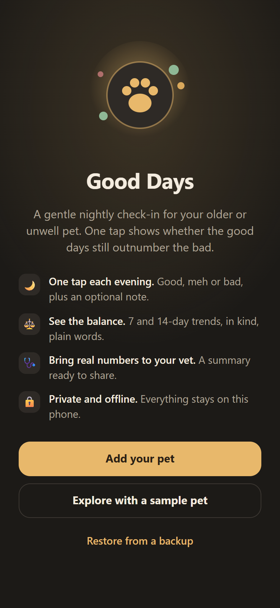
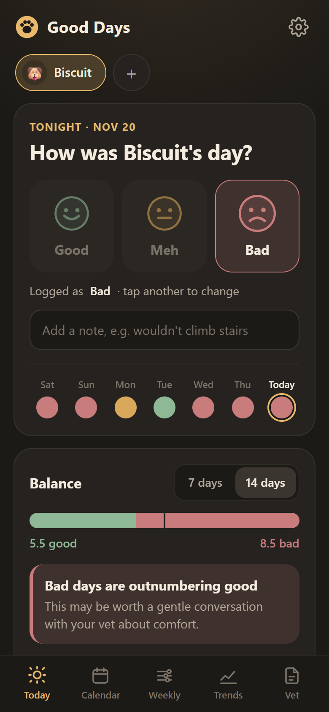
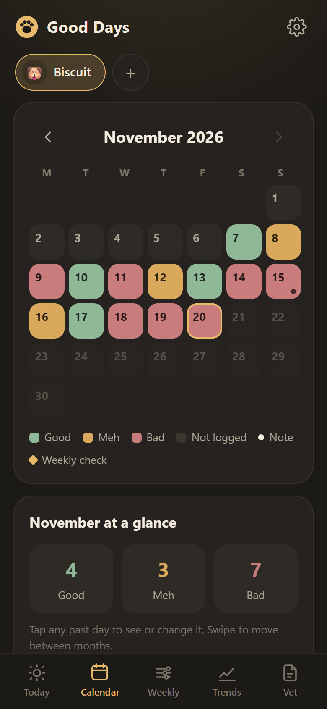
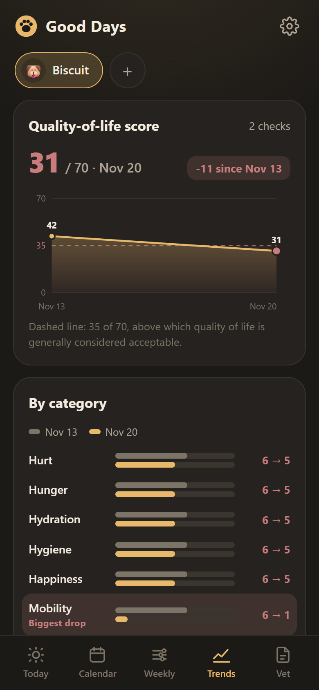
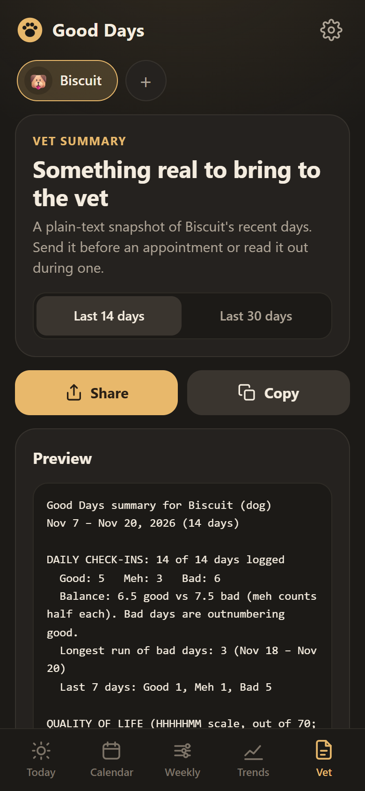

# Good Days

**A gentle daily check-in for your aging pet: one tap a night shows whether the good days still outnumber the bad, and gives you something real to bring to the vet.**

## The problem

Vets tell owners of senior or chronically ill pets to "mark a calendar: good day, bad day" and to watch whether bad days start to outnumber good ones over one to two weeks. They also point owners to the HHHHHMM quality-of-life scale (Hurt, Hunger, Hydration, Hygiene, Happiness, Mobility, More good days than bad). Most people end up doing this on paper calendars, printable PDFs or subscription apps. When you're grieving, the trend is hard to see. Vets say these logs show them what daily life at home really looks like, which a short clinic visit can't, but owners rarely have the numbers ready when they need them.

Evidence:

- [Lap of Love (vet hospice)](https://info.lapoflove.com/what-signs-indicate-my-pets-quality-of-life-is-declining): if bad days become more frequent than good days over one to two weeks, comfort may be getting harder to maintain.
- [Petco](https://prd-stgext-content.petco.com/content/content-hub/home/questions/01/37/638962.html): mark each evening as a good, bad or mediocre day. This is the same 3-state check-in the app uses.
- [VCA Hospitals](https://vcahospitals.com/know-your-pet/quality-of-life-at-the-end-of-life-for-your-dog): quality of life is compromised when bad days outnumber good ones, or when there are too many bad days in a row.
- [dvm360](https://www.dvm360.com/view/don-t-wait-for-the-bad-days-rethinking-quality-of-life-assessment-for-senior-pets): start assessing quality of life early, before a crisis.
- [Merck Vet Manual](https://www.merckvetmanual.com/multimedia/table/hhhhhmm-quality-of-life-scale): the HHHHHMM scale has 7 categories scored 0–10. A total above 35 is generally acceptable.
- [Etsy](https://www.etsy.com/listing/4529068828): people buy printable paper trackers. Paper can't compute rolling ratios or streaks.
- [Ralph](https://ralph-pet-website.pages.dev/for-pet-owners): the existing app in this niche charges a monthly subscription for its modules.

## Features

- **Nightly one-tap check-in.** Rate the day Good, Meh or Bad and add an optional one-line note. You can back-fill or edit any of the last 7 days from a quick strip.
- **Multiple pets.** Each pet has a name, species, birth year, emoji avatar and color. Switch between them with chips at the top.
- **Rolling balance gauge.** Shows the last 7 or 14 days, with Meh counting as half on each side. The status text is gentle: "Mostly good days", "Mixed: keep watching" or "Bad days are outnumbering good". The app also flags runs of 3 or more bad days in a row.
- **Weekly HHHHHMM check.** Seven sliders with plain-English hints and a live total out of 70, measured against the 35 reference line.
- **Favorite Things.** List 3–5 things your pet loves. Each week you tick "Still does this?" and the app tracks when each one was last seen.
- **Calendar heatmap.** A month grid in sage, sand and rose, with dots for notes and markers for weekly checks. Tap a day to edit it, or swipe between months.
- **Trends.** A sparkline of QoL totals with the 35 line, latest-vs-previous bars for each category with the biggest drop highlighted, monthly good/meh/bad stacks, and a "last seen" list for favorites.
- **Vet summary.** A plain-text summary of the last 14 or 30 days: counts, longest bad streak, HHHHHMM totals and biggest changes, favorites no longer seen, and recent notes. Send it with the native share sheet or copy it.
- **Memorial mode.** Check-ins stop, the history stays readable, and the wording changes gently.
- **Private and offline.** Your data stays on the phone. You can back it up to JSON (export/import), archive pets, or reset everything.
- On first launch you can try a sample pet, so the app has data to explore right away.

## Screenshots

| Welcome | Today | Calendar | Trends | Vet summary |
|---|---|---|---|---|
|  |  |  |  |  |

## Install

Download `app-release.apk` from this repository's **GitHub Releases** page and open it on your Android phone. You may need to allow installs from your browser or file manager.

## Tech notes

- Vanilla HTML, CSS and JavaScript in `app/src/main/assets/www/`, running in a thin Android WebView shell (`MainActivity.java`). No frameworks, no CDNs, no network requests.
- State is stored as a single JSON object in `localStorage` under the key `gooddays.v1`, holding pets, days, checks and settings. All dates are local-time ISO day strings.
- Optional native bridge, feature-detected: `Android.vibrate` for a soft buzz on check-in, `Android.share` for the vet summary and backups. The hardware back button closes sheets first, then returns to Today.
- All dialogs are built in-app. The app uses the system font stack, honors safe areas and supports `prefers-reduced-motion`.
- Browser QA: `_qa/scenario.js` runs through all 10 test scenarios from the spec with Playwright.

Built autonomously by the Auto Builder agent swarm (Claude Code).
